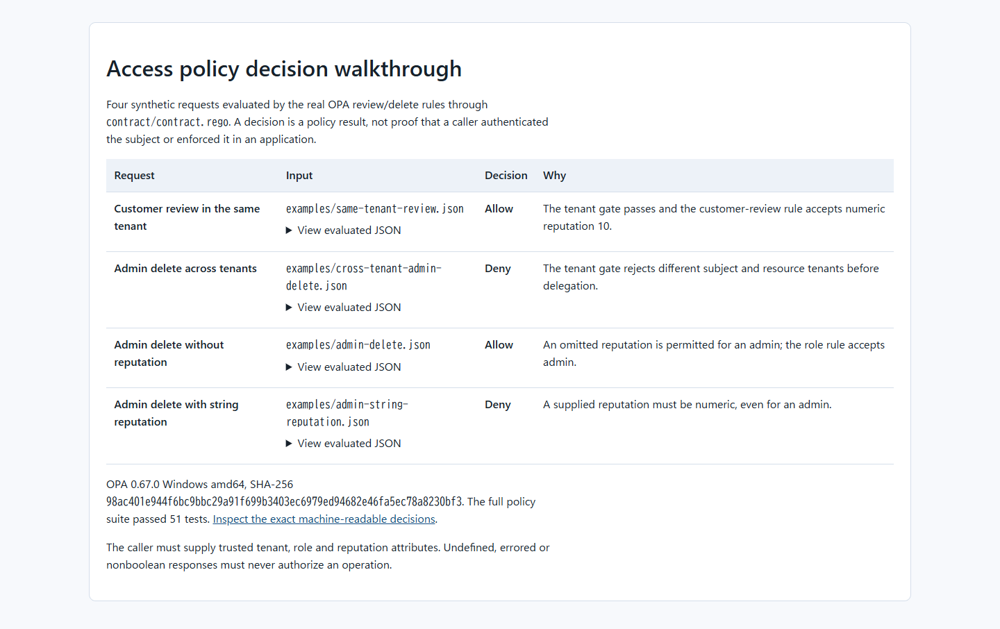

# Access Policy Contracts

Review tenant-bound `review` and `delete` decisions before connecting an
application to an authorization policy. This local example evaluates four
synthetic requests through the actual OPA rules and shows why two are allowed
and two are denied. It is useful to an engineer or reviewer checking a policy
contract; it does not authenticate a user or enforce a decision in an app.



| Synthetic request | Observed policy decision | Key condition |
| --- | --- | --- |
| Customer reviews in the same tenant, reputation `10` | Allow | The customer-review rule accepts it. |
| Admin deletes across tenants | Deny | The tenant gate rejects it before delegation. |
| Admin deletes in the same tenant, reputation omitted | Allow | The admin role rule accepts it. |
| Admin deletes in the same tenant, reputation `"100"` | Deny | A supplied reputation must be numeric. |

Open the [offline decision matrix](examples/decision-matrix.html) for the
readable walkthrough, or inspect the [observed JSON](examples/decision-results.json)
and [input files](examples/). The report embeds each evaluated input, so it
works from any output directory. The fourth case is a counterexample:
the same admin role that can delete with reputation omitted is denied when the
request supplies a string value. These results were generated by OPA 0.67.0,
not by a stand-in policy.

## Run the walkthrough

Use PowerShell 7 on Windows amd64. Download the official OPA 0.67.0 executable
and verify its published SHA-256. From the repository root:

```powershell
New-Item -ItemType Directory -Force .tools | Out-Null
Invoke-WebRequest 'https://github.com/open-policy-agent/opa/releases/download/v0.67.0/opa_windows_amd64.exe' -OutFile '.tools/opa.exe'
$opa = (Resolve-Path '.tools/opa.exe').Path
if ((Get-FileHash $opa -Algorithm SHA256).Hash.ToLowerInvariant() -ne '98ac401e944f6bc9bbc29a91f699b3403ec6979ed94682e46fa5ec78a8230bf3') { throw 'OPA checksum mismatch' }
pwsh -NoProfile -File tools/run-demo.ps1 -Opa $opa
```

The runner checks the executable hash again, runs the entire OPA policy test
suite, evaluates all four inputs with `--strict-builtin-errors`, requires an
explicit boolean result for every case, and writes both examples above. Its
observed terminal result was:

```text
Policy tests: 51 passed, 0 failed
same-tenant-review: true
cross-tenant-admin-delete: false
admin-delete: true
admin-string-reputation: false
```

The output files are deterministic and can be regenerated offline after OPA is
available. The script refuses a different OPA executable checksum or a changed
decision. The test suite contains the policy tests and the added
contract cases; the four examples exercise the runtime query without loading
test modules into the decision path.

## Follow the decision through the code

1. [Fixture input](examples/) supplies a `subject`, `resource` and action.
2. [The contract](contract/contract.rego) requires nonblank, exactly matching
   tenant strings and a nonblank role; it accepts only `review` or `delete`.
   Review requires numeric reputation. Delete requires numeric reputation or
   an admin with reputation **omitted**. Values are never normalized.
3. The contract delegates to the [main review/delete rules](components/contrib/academy-samples/opa-by-example/review_authz_example/rules_and_data/main/rules.rego)
   and [role rules](components/contrib/academy-samples/opa-by-example/review_authz_example/rules_and_data/policy/role/rules.rego).
   Their result becomes `data.access_contract.allow`, with `false` as default.
4. [The runner](tools/run-demo.ps1) queries that decision and checks it against
   the expected contract. [The tests](contract/contract_test.rego) cover other
   malformed, cross-tenant and threshold cases.

The runtime query uses only those two policy modules and the contract.
`true` is the only permissive result. An application integration must reject
errors, undefined values and nonboolean responses, and must supply
authenticated identities and trusted, current subject and resource attributes.

## Verification and limits

The local verification run passed all 51 OPA tests and all four
direct evaluations with the checksum-verified official Windows amd64 binary.
[VERIFICATION.md](VERIFICATION.md) records the earlier original/copy/assembly
checks and their limits; the new walkthrough is also checked into
[decision-results.json](examples/decision-results.json). The
[Windows workflow](.github/workflows/checks.yml) is configured to repeat the
same policy tests and demo in a fresh runner directory and compare both
committed reports; it has not run on GitHub yet. No newer OPA version, other
platform, application integration or production security result is claimed.

This component is an acceptance example, not a complete identity, policy
administration or enforcement system. The tested policy syntax requires the
OPA runtime boundary above. License terms and required notices are in
[NOTICE](NOTICE).
[RESEARCH.md](RESEARCH.md) provides background, not deployment validation.
